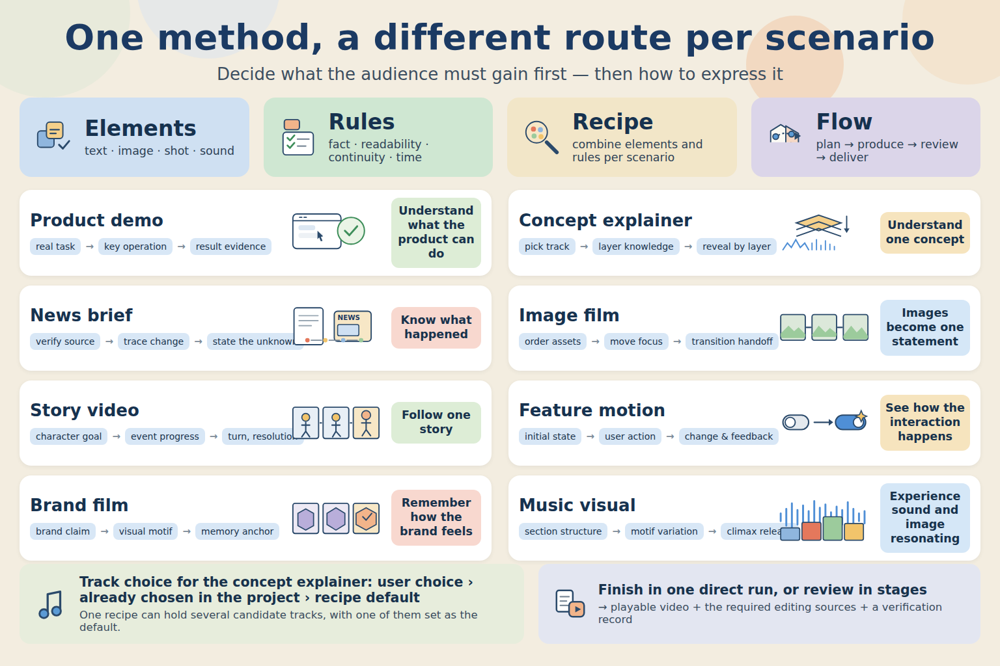

# Chaojifeng's video design methodology

A skill that helps an AI agent design and produce video. It turns a subject, a product and a set of assets into a revisable storyboard and production plan, organises shots, text, narration, music and rhythm, then carries the work through preview, review, rework and delivery of the finished film.

Built for product demos, knowledge explainers, music explainers, rap explainers, news briefs, image-driven films, stories and brand films. It also covers the plan only, a storyboard, a single motion effect, or a local revision of an existing piece.

| Video tasks | Optional styles | In-repo samples | Base motion | Expression guidance | Compose recipes |
| --- | --- | --- | --- | --- | --- |
| **8 kinds** | **66 packs** | **59 clips** | **12 items** | **64 items** | **18 categories** |

Production follows the tools the project already has; rendering, voiceover and export come from the agent environment that runs the skill.

[Get started](#getting-started) · [What the library builds on](#what-the-library-builds-on) · [The seven base styles](#the-seven-base-styles-this-library-maintains) · [59 integrated styles](#59-film-styles-integrated-from-open-source) · [Style gallery](assets/gallery/index.html)

## What the library builds on

The library brings the creative method, the style resources and the production tooling together. Below is what each part actually comes from, so you can choose and extend it.

| Part | Origin and maintenance | What it gives you |
| --- | --- | --- |
| Directorial method, scene arrangement, expression catalog and compose recipes | Original synthesis and adaptation by this library, from practice and outside research | Start from what the audience must understand, then arrange the spine, shots, evidence, sound and revision |
| 7 base styles | The library's own configurations and rules, maintained continuously | Everyday starting points for product, reading, relationship diagrams, imagery, collage and launch films |
| 59 film styles, key frames, cases and samples | Integrated from [LemoLab · Lemo-Opuscar](https://github.com/lemomo-ai/lemo-opuscar) | Adds ink wash, print, documentary, pixel, cartoon, material and 3D expression |
| Unified style packs, Chinese-name lookup, external collections and offline gallery | Adapted independently by this library after studying Lemo-Opuscar's engineering layers | Puts the original and the integrated styles in one catalog that can be queried, compared, derived from and reused |
| Plan and delivery specs, asset and media checks, sound event audit and other tools | Implemented independently by this library | Check timing, references, files, real media information and delivery completeness |

The library's original work is concentrated in the method synthesis, task arrangement, configuration, plan specs, tools and practice cases. The design and directing method also draws on community projects and creators' experience; see [method sources](references/sources.md) for what is borrowed and what is implemented independently.

## 8 kinds of video task



| Scenario | How the content is organised | What the audience gets |
| --- | --- | --- |
| Product demo | Real task → key operation → result evidence | See what the product can do |
| Knowledge explainer | Verify facts → build relationships → explain layer by layer | Understand a concept, a relationship or a process |
| News brief | Check sources → trace the change → organise evidence | Know what happened |
| Image-driven film | Order the assets → move the focus → hand off through transitions | Images join into one statement |
| Story video | Character goal → events advance → turn and resolution | Follow a story |
| Feature motion | Initial state → triggered action → change and feedback | See how the interaction happens |
| Brand film | Brand claim → visual motif → memory anchor | Remember how the brand feels |
| Music and visual performance | Section structure → motif variation → release at the peak | Feel sound and picture resonate |

Knowledge explainers also cover two arrangements: concept knowledge explainers and hip-hop knowledge explainers. The beat can be led by narration, music, lyrics, a process or a relationship, chosen by subject.

## What this library can direct and produce

| Capability | How it is used in a piece | Read further |
| --- | --- | --- |
| Spine and shot design | State the viewer change, each shot's focus, the reveal order, the stable dwell and the handoff to the next shot | [Creative direction](references/creative-direction.md) |
| First frame and the first three seconds | Open on the subject, the task or the change; check the emphasis and the information density | [Opening design](references/opening-design.md) |
| Product task proof | Build the interface, the result and the comparison around a real operation, so the feature has picture evidence | [Product expression](references/product-expression.md) |
| Concept knowledge explainer | Lay out facts, relationships, carriers and a layer-by-layer reveal, arranged to the real music and reading time | [Explainer arrangement](references/knowledge-music-direction.md) |
| Hip-hop knowledge explainer | Verify the knowledge and the singable lyrics first, then place picture, subtitles and sound hits against the real audio track | [Rap arrangement](references/knowledge-rap-direction.md) |
| Narration, subtitles and music | Get the real audio first, then arrange sections, lead sound, SFX, subtitles and seams | [Sound and rhythm](references/sound-and-rhythm.md) |
| Asset choice and routing | Choose screen recordings, photos, footage, graphics, generated assets and 3D, and keep each one's job | [Asset routing](references/asset-routing.md) |
| Local revision and review | Revise by shot, object or time window, then re-check the affected subtitles, sound and seams | [Review and revision](references/review-and-revision.md) |
| Continuous production or staged review | When a direct finished film is asked for, complete it in one run; when storyboard review is wanted, stop at the agreed checkpoints | [Production workflow](references/production-workflow.md) |

## The seven base styles this library maintains

These keep the library's original IDs. Use them as starting points for everyday films, then combine them with the expressions and recipes below.

| Base style | Visual direction | Content it suits |
| --- | --- | --- |
| [清晰产品](styles/product-minimal/STYLE.md) | Restrained whitespace, interface and operation to the fore | Product intros, feature demos, task proof |
| [纸面编辑](styles/paper-editorial/STYLE.md) | Paper reading and editorial layout | Knowledge explainers, document explainers, reading-led content |
| [暗色技术](styles/dark-tech/STYLE.md) | Dark space with a clear information hierarchy | Technical notes, information flows, state changes |
| [单色图解](styles/mono-diagram/STYLE.md) | Position, lines and a single colour carry the relationships | System mechanics, processes, concept explanations |
| [影像叙事](styles/cinematic-photo/STYLE.md) | Photos and filmed subjects carry the narrative | People, travel, image-driven films, filmed stories |
| [鲜明拼贴](styles/vivid-collage/STYLE.md) | Images cut to blocks, vivid colour and changes of scale | Rhythm shorts, events, brand and music visuals |
| [双底色发布片](styles/dual-ground-launch/STYLE.md) | Two ground colours string problem and answer together | Product launches, feature chapters, before-and-after of a task |

## Creative cases and accumulated practice

### Small Rounded Corners

https://github.com/user-attachments/assets/d87f8264-0a95-40d6-adbb-4e7e0afa32d3

A 22-second vertical piece that strings a rounded-corner slide, a batch pass over nine images and a ring of small cards into one stretch. Click the player to watch; the volume button turns the sound on.

### AI Level-Up Log

https://github.com/user-attachments/assets/bced29b5-a55a-4f92-85a5-865c6730752a

About 18.6 seconds, landscape highlight: an opening countdown joined to the “level-up” chorus. Click the player to watch; the volume button turns the sound on.

Both pieces were made collaboratively in Cursor. The excerpt choices, the method mapping and the creative sources are in the [case notes](examples/showcase/README.md).

## 59 film styles integrated from open source

The styles below, their key frames and samples come from [LemoLab · Lemo-Opuscar](https://github.com/lemomo-ai/lemo-opuscar); thanks to the author for sharing them openly. The library wires them into the unified style packs and the Chinese-name catalog, keeping the rules, case notes, usable text sources and samples so the current film can select and adapt them.

Click a frame to read the style rules, click “Sample” to open the video held in this repository. All 59 samples ship with the library, so once the full catalog is downloaded you can play them offline in the [style gallery](assets/gallery/index.html); three of them keep the picture and drop the restricted audio track. Sources and changes are in the [asset manifest](THIRD_PARTY_NOTICES.md).

### Editing and documentary · 8 packs

<table>
<tr>
<td width="33%" valign="top"><a href="styles/opuscar-caption-news/STYLE.md"></a><br><b>字幕新闻</b><br><sub>Caption News</sub><br><sub>资讯呈现／故事视频／图片成片</sub><br><a href="styles/opuscar-caption-news/STYLE.md">Rules</a> · <a href="styles/opuscar-caption-news/sample.mp4">Sample</a></td>
<td width="33%" valign="top"><a href="styles/opuscar-city-symphony/STYLE.md"></a><br><b>延时交响</b><br><sub>Time-lapse Symphony</sub><br><sub>资讯呈现／故事视频／图片成片</sub><br><a href="styles/opuscar-city-symphony/STYLE.md">Rules</a> · <a href="styles/opuscar-city-symphony/sample.mp4">Sample</a></td>
<td width="33%" valign="top"><a href="styles/opuscar-countdown/STYLE.md"></a><br><b>实时倒计时分屏</b><br><sub>Live Countdown Split-screen</sub><br><sub>资讯呈现／故事视频／图片成片</sub><br><a href="styles/opuscar-countdown/STYLE.md">Rules</a> · <a href="styles/opuscar-countdown/sample.mp4">Sample</a></td>
</tr>
<tr>
<td width="33%" valign="top"><a href="styles/opuscar-kino-montage/STYLE.md"></a><br><b>构成主义蒙太奇</b><br><sub>Constructivist Montage</sub><br><sub>资讯呈现／故事视频／图片成片</sub><br><a href="styles/opuscar-kino-montage/STYLE.md">Rules</a> · <a href="styles/opuscar-kino-montage/sample.mp4">Sample</a></td>
<td width="33%" valign="top"><a href="styles/opuscar-news-package/STYLE.md"></a><br><b>电视新闻包装</b><br><sub>Broadcast News Package</sub><br><sub>资讯呈现／故事视频／图片成片</sub><br><a href="styles/opuscar-news-package/STYLE.md">Rules</a> · <a href="styles/opuscar-news-package/sample.mp4">Sample</a></td>
<td width="33%" valign="top"><a href="styles/opuscar-newsreel/STYLE.md"></a><br><b>1920s 新闻影片</b><br><sub>1920s Newsreel</sub><br><sub>资讯呈现／故事视频／图片成片</sub><br><a href="styles/opuscar-newsreel/STYLE.md">Rules</a> · <a href="styles/opuscar-newsreel/sample.mp4">Sample</a></td>
</tr>
<tr>
<td width="33%" valign="top"><a href="styles/opuscar-telestrator/STYLE.md"></a><br><b>体育战术板</b><br><sub>Sports Telestrator</sub><br><sub>资讯呈现／故事视频／图片成片</sub><br><a href="styles/opuscar-telestrator/STYLE.md">Rules</a> · <a href="styles/opuscar-telestrator/sample.mp4">Sample</a></td>
<td width="33%" valign="top"><a href="styles/opuscar-visual-investigation/STYLE.md"></a><br><b>视觉调查</b><br><sub>Visual Investigation</sub><br><sub>资讯呈现／故事视频／图片成片</sub><br><a href="styles/opuscar-visual-investigation/STYLE.md">Rules</a> · <a href="styles/opuscar-visual-investigation/sample.mp4">Sample</a></td>
</tr>
</table>

### Evidence-based imagery · 8 packs

<table>
<tr>
<td width="33%" valign="top"><a href="styles/opuscar-archive-lighttable/STYLE.md"></a><br><b>档案灯台</b><br><sub>Archive Light Table</sub><br><sub>知识讲解／资讯呈现／产品演示</sub><br><a href="styles/opuscar-archive-lighttable/STYLE.md">Rules</a> · <a href="styles/opuscar-archive-lighttable/sample.mp4">Sample</a></td>
<td width="33%" valign="top"><a href="styles/opuscar-briefing-board/STYLE.md"></a><br><b>工程简报板</b><br><sub>Engineering Briefing Board</sub><br><sub>知识讲解／资讯呈现／产品演示</sub><br><a href="styles/opuscar-briefing-board/STYLE.md">Rules</a> · <a href="styles/opuscar-briefing-board/sample.mp4">Sample</a></td>
<td width="33%" valign="top"><a href="styles/opuscar-data-physical/STYLE.md"></a><br><b>数据实物化</b><br><sub>Data Physicalization</sub><br><sub>知识讲解／资讯呈现／产品演示</sub><br><a href="styles/opuscar-data-physical/STYLE.md">Rules</a> · <a href="styles/opuscar-data-physical/sample.mp4">Sample</a></td>
</tr>
<tr>
<td width="33%" valign="top"><a href="styles/opuscar-lidar-survey/STYLE.md"></a><br><b>点云测绘</b><br><sub>LiDAR Survey</sub><br><sub>知识讲解／资讯呈现／产品演示</sub><br><a href="styles/opuscar-lidar-survey/STYLE.md">Rules</a> · <a href="styles/opuscar-lidar-survey/sample.mp4">Sample</a></td>
<td width="33%" valign="top"><a href="styles/opuscar-microscope/STYLE.md"></a><br><b>显微叙事</b><br><sub>Microscope Story</sub><br><sub>知识讲解／资讯呈现／产品演示</sub><br><a href="styles/opuscar-microscope/STYLE.md">Rules</a> · <a href="styles/opuscar-microscope/sample.mp4">Sample</a></td>
<td width="33%" valign="top"><a href="styles/opuscar-satellite-briefing/STYLE.md"></a><br><b>卫星简报</b><br><sub>Satellite Briefing</sub><br><sub>知识讲解／资讯呈现／产品演示</sub><br><a href="styles/opuscar-satellite-briefing/STYLE.md">Rules</a> · <a href="styles/opuscar-satellite-briefing/sample.mp4">Sample</a></td>
</tr>
<tr>
<td width="33%" valign="top"><a href="styles/opuscar-teardown/STYLE.md"></a><br><b>产品拆解</b><br><sub>Exploded Teardown</sub><br><sub>知识讲解／资讯呈现／产品演示</sub><br><a href="styles/opuscar-teardown/STYLE.md">Rules</a> · <a href="styles/opuscar-teardown/sample.mp4">Sample</a></td>
<td width="33%" valign="top"><a href="styles/opuscar-white-model/STYLE.md"></a><br><b>白模投影</b><br><sub>Projection on White Model</sub><br><sub>知识讲解／资讯呈现／产品演示</sub><br><a href="styles/opuscar-white-model/STYLE.md">Rules</a> · <a href="styles/opuscar-white-model/sample.mp4">Sample</a></td>
</tr>
</table>

### Hand-drawn and painted · 7 packs

<table>
<tr>
<td width="33%" valign="top"><a href="styles/opuscar-crayon-book/STYLE.md"></a><br><b>蜡笔儿童绘本</b><br><sub>Crayon Picture Book</sub><br><sub>故事视频／知识讲解／品牌形象短片</sub><br><a href="styles/opuscar-crayon-book/STYLE.md">Rules</a> · <a href="styles/opuscar-crayon-book/sample.mp4">Sample</a></td>
<td width="33%" valign="top"><a href="styles/opuscar-impasto/STYLE.md"></a><br><b>油画厚涂</b><br><sub>Impasto Oil Painting</sub><br><sub>故事视频／知识讲解／品牌形象短片</sub><br><a href="styles/opuscar-impasto/STYLE.md">Rules</a> · <a href="styles/opuscar-impasto/sample.mp4">Sample</a></td>
<td width="33%" valign="top"><a href="styles/opuscar-ink-wash/STYLE.md"></a><br><b>中国水墨</b><br><sub>Chinese Ink Wash</sub><br><sub>故事视频／知识讲解／品牌形象短片</sub><br><a href="styles/opuscar-ink-wash/STYLE.md">Rules</a> · <a href="styles/opuscar-ink-wash/sample.mp4">Sample</a></td>
</tr>
<tr>
<td width="33%" valign="top"><a href="styles/opuscar-one-line/STYLE.md"></a><br><b>一笔画</b><br><sub>One-line Drawing</sub><br><sub>故事视频／知识讲解／品牌形象短片</sub><br><a href="styles/opuscar-one-line/STYLE.md">Rules</a> · <a href="styles/opuscar-one-line/sample.mp4">Sample</a></td>
<td width="33%" valign="top"><a href="styles/opuscar-urban-sketch/STYLE.md"></a><br><b>钢笔淡彩</b><br><sub>Urban Sketch · Pen &amp; Wash</sub><br><sub>故事视频／知识讲解／品牌形象短片</sub><br><a href="styles/opuscar-urban-sketch/STYLE.md">Rules</a> · <a href="styles/opuscar-urban-sketch/sample.mp4">Sample</a></td>
<td width="33%" valign="top"><a href="styles/opuscar-watercolor/STYLE.md"></a><br><b>水彩笔刷</b><br><sub>Watercolor Brush</sub><br><sub>故事视频／知识讲解／品牌形象短片</sub><br><a href="styles/opuscar-watercolor/STYLE.md">Rules</a> · <a href="styles/opuscar-watercolor/sample.mp4">Sample</a></td>
</tr>
<tr>
<td width="33%" valign="top"><a href="styles/opuscar-whiteboard/STYLE.md"></a><br><b>白板讲解</b><br><sub>Whiteboard Explainer</sub><br><sub>故事视频／知识讲解／品牌形象短片</sub><br><a href="styles/opuscar-whiteboard/STYLE.md">Rules</a> · <a href="styles/opuscar-whiteboard/sample.mp4">Sample</a></td>
</tr>
</table>

### Eastern tradition · 4 packs

<table>
<tr>
<td width="33%" valign="top"><a href="styles/opuscar-paper-lantern/STYLE.md"></a><br><b>纸雕灯影</b><br><sub>Paper-cut Lightbox</sub><br><sub>故事视频／品牌形象短片／音乐与视觉表演</sub><br><a href="styles/opuscar-paper-lantern/STYLE.md">Rules</a> · <a href="styles/opuscar-paper-lantern/sample.mp4">Sample</a></td>
<td width="33%" valign="top"><a href="styles/opuscar-papercut-red/STYLE.md"></a><br><b>红色窗花剪纸</b><br><sub>Red Paper-cut</sub><br><sub>故事视频／品牌形象短片／音乐与视觉表演</sub><br><a href="styles/opuscar-papercut-red/STYLE.md">Rules</a> · <a href="styles/opuscar-papercut-red/sample.mp4">Sample</a></td>
<td width="33%" valign="top"><a href="styles/opuscar-shadow-puppet/STYLE.md"></a><br><b>皮影戏</b><br><sub>Shadow Puppetry</sub><br><sub>故事视频／品牌形象短片／音乐与视觉表演</sub><br><a href="styles/opuscar-shadow-puppet/STYLE.md">Rules</a> · <a href="styles/opuscar-shadow-puppet/sample.mp4">Sample</a></td>
</tr>
<tr>
<td width="33%" valign="top"><a href="styles/opuscar-ukiyoe/STYLE.md"></a><br><b>浮世绘</b><br><sub>Ukiyo-e</sub><br><sub>故事视频／品牌形象短片／音乐与视觉表演</sub><br><a href="styles/opuscar-ukiyoe/STYLE.md">Rules</a> · <a href="styles/opuscar-ukiyoe/sample.mp4">Sample</a></td>
</tr>
</table>

### Print and engraving · 5 packs

<table>
<tr>
<td width="33%" valign="top"><a href="styles/opuscar-engraving/STYLE.md"></a><br><b>铜版画</b><br><sub>Copperplate Engraving</sub><br><sub>资讯呈现／故事视频／品牌形象短片</sub><br><a href="styles/opuscar-engraving/STYLE.md">Rules</a> · <a href="styles/opuscar-engraving/sample.mp4">Sample</a></td>
<td width="33%" valign="top"><a href="styles/opuscar-halftone-dossier/STYLE.md"></a><br><b>复古半调案卷</b><br><sub>Halftone Dossier</sub><br><sub>资讯呈现／故事视频／品牌形象短片</sub><br><a href="styles/opuscar-halftone-dossier/STYLE.md">Rules</a> · <a href="styles/opuscar-halftone-dossier/sample.mp4">Sample</a></td>
<td width="33%" valign="top"><a href="styles/opuscar-risograph/STYLE.md"></a><br><b>Risograph 孔版印刷</b><br><sub>Risograph Print</sub><br><sub>资讯呈现／故事视频／品牌形象短片</sub><br><a href="styles/opuscar-risograph/STYLE.md">Rules</a> · <a href="styles/opuscar-risograph/sample.mp4">Sample</a></td>
</tr>
<tr>
<td width="33%" valign="top"><a href="styles/opuscar-silkscreen-poster/STYLE.md"></a><br><b>丝印旅行海报</b><br><sub>Silkscreen Travel Poster</sub><br><sub>资讯呈现／故事视频／品牌形象短片</sub><br><a href="styles/opuscar-silkscreen-poster/STYLE.md">Rules</a> · <a href="styles/opuscar-silkscreen-poster/sample.mp4">Sample</a></td>
<td width="33%" valign="top"><a href="styles/opuscar-woodcut/STYLE.md"></a><br><b>木刻版画</b><br><sub>Woodcut Print</sub><br><sub>资讯呈现／故事视频／品牌形象短片</sub><br><a href="styles/opuscar-woodcut/STYLE.md">Rules</a> · <a href="styles/opuscar-woodcut/sample.mp4">Sample</a></td>
</tr>
</table>

### Graphics and typography · 7 packs

<table>
<tr>
<td width="33%" valign="top"><a href="styles/opuscar-art-deco/STYLE.md"></a><br><b>装饰艺术</b><br><sub>Art Deco</sub><br><sub>知识讲解／功能动效／品牌形象短片</sub><br><a href="styles/opuscar-art-deco/STYLE.md">Rules</a> · <a href="styles/opuscar-art-deco/sample.mp4">Sample</a></td>
<td width="33%" valign="top"><a href="styles/opuscar-ascii-crt/STYLE.md"></a><br><b>ASCII / CRT 终端</b><br><sub>ASCII / CRT Terminal</sub><br><sub>知识讲解／功能动效／品牌形象短片</sub><br><a href="styles/opuscar-ascii-crt/STYLE.md">Rules</a> · <a href="styles/opuscar-ascii-crt/sample.mp4">Sample</a></td>
<td width="33%" valign="top"><a href="styles/opuscar-blueprint/STYLE.md"></a><br><b>蓝图 / 工程制图</b><br><sub>Blueprint</sub><br><sub>知识讲解／功能动效／品牌形象短片</sub><br><a href="styles/opuscar-blueprint/STYLE.md">Rules</a> · <a href="styles/opuscar-blueprint/sample.mp4">Sample</a></td>
</tr>
<tr>
<td width="33%" valign="top"><a href="styles/opuscar-pictogram-motion/STYLE.md"></a><br><b>象形运动图形</b><br><sub>Pictogram Motion</sub><br><sub>知识讲解／功能动效／品牌形象短片</sub><br><a href="styles/opuscar-pictogram-motion/STYLE.md">Rules</a> · <a href="styles/opuscar-pictogram-motion/sample.mp4">Sample</a></td>
<td width="33%" valign="top"><a href="styles/opuscar-spy-titles/STYLE.md"></a><br><b>60s 间谍片头</b><br><sub>60s Spy Title Sequence</sub><br><sub>知识讲解／功能动效／品牌形象短片</sub><br><a href="styles/opuscar-spy-titles/STYLE.md">Rules</a> · <a href="styles/opuscar-spy-titles/sample.mp4">Sample</a></td>
<td width="33%" valign="top"><a href="styles/opuscar-stained-glass/STYLE.md"></a><br><b>彩色玻璃窗</b><br><sub>Stained Glass</sub><br><sub>知识讲解／功能动效／品牌形象短片</sub><br><a href="styles/opuscar-stained-glass/STYLE.md">Rules</a> · <a href="styles/opuscar-stained-glass/sample.mp4">Sample</a></td>
</tr>
<tr>
<td width="33%" valign="top"><a href="styles/opuscar-swiss-motion/STYLE.md"></a><br><b>瑞士动态排版</b><br><sub>Swiss Motion Graphics</sub><br><sub>知识讲解／功能动效／品牌形象短片</sub><br><a href="styles/opuscar-swiss-motion/STYLE.md">Rules</a> · <a href="styles/opuscar-swiss-motion/sample.mp4">Sample</a></td>
</tr>
</table>

### Information and launch · 5 packs

<table>
<tr>
<td width="33%" valign="top"><a href="styles/opuscar-dark-keynote/STYLE.md"></a><br><b>暗色科技发布</b><br><sub>Dark Tech Keynote</sub><br><sub>产品演示／知识讲解／资讯呈现</sub><br><a href="styles/opuscar-dark-keynote/STYLE.md">Rules</a> · <a href="styles/opuscar-dark-keynote/sample.mp4">Sample</a></td>
<td width="33%" valign="top"><a href="styles/opuscar-dataviz/STYLE.md"></a><br><b>数据叙事</b><br><sub>Data Storytelling</sub><br><sub>产品演示／知识讲解／资讯呈现</sub><br><a href="styles/opuscar-dataviz/STYLE.md">Rules</a> · <a href="styles/opuscar-dataviz/sample.mp4">Sample</a></td>
<td width="33%" valign="top"><a href="styles/opuscar-hologram-hud/STYLE.md"></a><br><b>科幻全息界面</b><br><sub>Sci-fi Hologram HUD</sub><br><sub>产品演示／知识讲解／资讯呈现</sub><br><a href="styles/opuscar-hologram-hud/STYLE.md">Rules</a> · <a href="styles/opuscar-hologram-hud/sample.mp4">Sample</a></td>
</tr>
<tr>
<td width="33%" valign="top"><a href="styles/opuscar-iso-infographic/STYLE.md"></a><br><b>等距信息图</b><br><sub>Isometric Infographic</sub><br><sub>产品演示／知识讲解／资讯呈现</sub><br><a href="styles/opuscar-iso-infographic/STYLE.md">Rules</a> · <a href="styles/opuscar-iso-infographic/sample.mp4">Sample</a></td>
<td width="33%" valign="top"><a href="styles/opuscar-living-screencast/STYLE.md"></a><br><b>活体实机录屏</b><br><sub>Living Screencast</sub><br><sub>产品演示／知识讲解／资讯呈现</sub><br><a href="styles/opuscar-living-screencast/STYLE.md">Rules</a> · <a href="styles/opuscar-living-screencast/sample.mp4">Sample</a></td>
</tr>
</table>

### Cartoon and animation · 4 packs

<table>
<tr>
<td width="33%" valign="top"><a href="styles/opuscar-cel-anime-80s/STYLE.md"></a><br><b>80 年代赛璐璐动画</b><br><sub>80s Cel Anime</sub><br><sub>故事视频／知识讲解／音乐与视觉表演</sub><br><a href="styles/opuscar-cel-anime-80s/STYLE.md">Rules</a> · <a href="styles/opuscar-cel-anime-80s/sample.mp4">Sample</a></td>
<td width="33%" valign="top"><a href="styles/opuscar-midcentury-toon/STYLE.md"></a><br><b>50s 扁平卡通</b><br><sub>Mid-century Cartoon</sub><br><sub>故事视频／知识讲解／音乐与视觉表演</sub><br><a href="styles/opuscar-midcentury-toon/STYLE.md">Rules</a> · <a href="styles/opuscar-midcentury-toon/sample.mp4">Sample</a></td>
<td width="33%" valign="top"><a href="styles/opuscar-rubber-hose/STYLE.md"></a><br><b>1930s 橡皮管卡通</b><br><sub>1930s Rubber Hose Cartoon</sub><br><sub>故事视频／知识讲解／音乐与视觉表演</sub><br><a href="styles/opuscar-rubber-hose/STYLE.md">Rules</a> · <a href="styles/opuscar-rubber-hose/sample.mp4">Sample</a></td>
</tr>
<tr>
<td width="33%" valign="top"><a href="styles/opuscar-scifi-toon/STYLE.md"></a><br><b>科幻情景喜剧卡通</b><br><sub>Sci-Fi Sitcom Toon</sub><br><sub>故事视频／知识讲解／音乐与视觉表演</sub><br><a href="styles/opuscar-scifi-toon/STYLE.md">Rules</a> · <a href="styles/opuscar-scifi-toon/sample.mp4">Sample</a></td>
</tr>
</table>

### Games · 4 packs

<table>
<tr>
<td width="33%" valign="top"><a href="styles/opuscar-game-show/STYLE.md"></a><br><b>综艺节奏扁平</b><br><sub>Game Show Flat</sub><br><sub>故事视频／知识讲解／音乐与视觉表演</sub><br><a href="styles/opuscar-game-show/STYLE.md">Rules</a> · <a href="styles/opuscar-game-show/sample.mp4">Sample</a></td>
<td width="33%" valign="top"><a href="styles/opuscar-hd-2d/STYLE.md"></a><br><b>HD-2D</b><br><sub>HD-2D</sub><br><sub>故事视频／知识讲解／音乐与视觉表演</sub><br><a href="styles/opuscar-hd-2d/STYLE.md">Rules</a> · <a href="styles/opuscar-hd-2d/sample.mp4">Sample</a></td>
<td width="33%" valign="top"><a href="styles/opuscar-microgame/STYLE.md"></a><br><b>微游戏快闪</b><br><sub>Microgame Frenzy</sub><br><sub>故事视频／知识讲解／音乐与视觉表演</sub><br><a href="styles/opuscar-microgame/STYLE.md">Rules</a> · <a href="styles/opuscar-microgame/sample.mp4">Sample</a></td>
</tr>
<tr>
<td width="33%" valign="top"><a href="styles/opuscar-pixel-rpg/STYLE.md"></a><br><b>16-bit 像素 RPG</b><br><sub>16-bit Pixel RPG</sub><br><sub>故事视频／知识讲解／音乐与视觉表演</sub><br><a href="styles/opuscar-pixel-rpg/STYLE.md">Rules</a> · <a href="styles/opuscar-pixel-rpg/sample.mp4">Sample</a></td>
</tr>
</table>

### Cinema and period · 2 packs

<table>
<tr>
<td width="33%" valign="top"><a href="styles/opuscar-backrooms/STYLE.md"></a><br><b>后室 / 新怪谈</b><br><sub>Liminal Found Footage</sub><br><sub>故事视频／品牌形象短片／音乐与视觉表演</sub><br><a href="styles/opuscar-backrooms/STYLE.md">Rules</a> · <a href="styles/opuscar-backrooms/sample.mp4">Sample</a></td>
<td width="33%" valign="top"><a href="styles/opuscar-silent-film/STYLE.md"></a><br><b>1920s 默片</b><br><sub>1920s Silent Film</sub><br><sub>故事视频／品牌形象短片／音乐与视觉表演</sub><br><a href="styles/opuscar-silent-film/STYLE.md">Rules</a> · <a href="styles/opuscar-silent-film/sample.mp4">Sample</a></td>
</tr>
</table>

### Material and 3D · 5 packs

<table>
<tr>
<td width="33%" valign="top"><a href="styles/opuscar-brick-toy/STYLE.md"></a><br><b>积木玩具</b><br><sub>Brick Toy</sub><br><sub>产品演示／品牌形象短片／音乐与视觉表演</sub><br><a href="styles/opuscar-brick-toy/STYLE.md">Rules</a> · <a href="styles/opuscar-brick-toy/sample.mp4">Sample</a></td>
<td width="33%" valign="top"><a href="styles/opuscar-glass-product/STYLE.md"></a><br><b>玻璃质感产品</b><br><sub>Glass Product Render</sub><br><sub>产品演示／品牌形象短片／音乐与视觉表演</sub><br><a href="styles/opuscar-glass-product/STYLE.md">Rules</a> · <a href="styles/opuscar-glass-product/sample.mp4">Sample</a></td>
<td width="33%" valign="top"><a href="styles/opuscar-lowpoly-island/STYLE.md"></a><br><b>低多边形等距</b><br><sub>Low-poly Isometric Island</sub><br><sub>产品演示／品牌形象短片／音乐与视觉表演</sub><br><a href="styles/opuscar-lowpoly-island/STYLE.md">Rules</a> · <a href="styles/opuscar-lowpoly-island/sample.mp4">Sample</a></td>
</tr>
<tr>
<td width="33%" valign="top"><a href="styles/opuscar-paper-popup/STYLE.md"></a><br><b>纸片立体书</b><br><sub>Paper Pop-up Book</sub><br><sub>产品演示／品牌形象短片／音乐与视觉表演</sub><br><a href="styles/opuscar-paper-popup/STYLE.md">Rules</a> · <a href="styles/opuscar-paper-popup/sample.mp4">Sample</a></td>
<td width="33%" valign="top"><a href="styles/opuscar-tilt-shift/STYLE.md"></a><br><b>移轴微缩</b><br><sub>Tilt-Shift Miniature</sub><br><sub>产品演示／品牌形象短片／音乐与视觉表演</sub><br><a href="styles/opuscar-tilt-shift/STYLE.md">Rules</a> · <a href="styles/opuscar-tilt-shift/sample.mp4">Sample</a></td>
</tr>
</table>

## How to combine these capabilities

The scenario decides the task, the style decides the material and the visual language, the recipe arranges the whole film, and expressions and motion handle the local detail. They can be recombined for the subject at hand.

| What you want to make | How you might start |
| --- | --- |
| A product launch film | Product task proof + a clear-product or glass-product style + callouts on the key operations + result reveal |
| A concept knowledge explainer | Layer-by-layer progression + a mono-diagram or isometric infographic style + narration or a music arrangement |
| A hip-hop knowledge explainer | Facts and lyrics + a pixel or game-show-rhythm style + line-by-line subtitles on the real audio track |
| A news short | Evidence board + a caption-news or news-package style + primary material and data |
| An image and brand short | Real photos into the main frame + a cinematic-photo or vivid-collage style + a music motif and transitions |

### 18 kinds of compose recipe

A recipe is an arrangement the library distilled from creative research and practice: inputs, shot steps, expression combinations, check questions and adjustment methods.

| Recipe | How the content is organised |
| --- | --- |
| [The interface journey of one object](catalog/recipes.json) | Send the same interface object through several states, keeping space and motion continuous. |
| [Follow a signal to explain a system](catalog/recipes.json) | Follow a signal or an information unit, and explain the paths and changes inside the system. |
| [From the whole into the micro](catalog/recipes.json) | Move from the whole into the part and the micro detail, building scale references layer by layer. |
| [Real photos into the main frame](catalog/recipes.json) | Keep the subject of the real photo and use cropping, layout and camera to carry the emphasis. |
| [Music events become visible action](catalog/recipes.json) | Turn events in the music into visible action and change. |
| [Text carries the narrative action](catalog/recipes.json) | Let the arrival, the position and the movement of type carry the narrative. |
| [Data and comparison make the difference clear](catalog/recipes.json) | Establish a common baseline, then present the values, the relationships and the differences. |
| [A brand film with something to say](catalog/recipes.json) | Take the brand claim and push one visual motif forward again and again. |
| [Prove the product's value with a real task](catalog/recipes.json) | Enter from a user task into the real operation and close on a visible result. |
| [Add capability layer by layer on one clip](catalog/recipes.json) | Show the change on the same clip in layers, so the differences can be compared. |
| [The object is the explanation](catalog/recipes.json) | Let an object's structure, position and working process carry the explanation. |
| [Layer-by-layer progression for abstract concepts](catalog/recipes.json) | Establish the carrier and the relationships first, then add new information layer by layer. |
| [An evidence board explains the news](catalog/recipes.json) | Organise material, facts and comparisons into a clear line of information. |
| [The emotional arc of a launch film](catalog/recipes.json) | Arrange the rhythm around problem, turn, proof and action. |
| [Feature chapters in sequence](catalog/recipes.json) | Present a group of related features as consecutive chapters. |
| [Product music narrative](catalog/recipes.json) | Arrange product action, lyrics, music sections and picture changes together. |
| [Concept knowledge explainer](catalog/recipes.json) | Organise the knowledge layers, keywords, subtitles and reveal points to the chosen music. |
| [Hip-hop knowledge explainer](catalog/recipes.json) | Get the verified knowledge into singable lyrics, then arrange sound and picture to the real audio track. |

### 64 items of expression guidance

Expression items are synthesised and adapted by this library; each states the purpose, inputs, parameters and checks of one local technique. The full set is in the [expression catalog](assets/gallery/expressions.html).

| Category | Expressions included |
| --- | --- |
| Narrative · 9 items | Goal to evidence, follow one information unit, continuous scale explanation, visual energy rise and fall, one subject carried through change, pain-point evidence to a verdict ladder, the product is the evidence with the excerpt marked, parallel promise chapters, action as invocation |
| Camera · 4 items | Push in and retreat to context, route tour shot, motion-compensated framing, pull back to reveal and click-through |
| Transition · 6 items | Shared-form transition, compositional match cut, reveal after an occluder, object breaks the frame, continuous exit along a tangent, action-causal seam |
| Visual · 9 items | Action linked to a counter, media-space array, structural teardown and reassembly, controlled particle field, continuous material change, target frame and semantic callout, bounded treatment with result reveal, magnitude whip with digit counting, replica interface with a recognisable shell |
| Animation · 4 items | Spring landing on target, differential stretch on lead and trail edges, grow and flow along a path, fill and transfer |
| Type · 6 items | Emphasis that follows meaning, type set along a curve, letter-direction compensation, read before it moves, the typing narrator, verdict card and three voices |
| Sound · 5 items | Beat mapping, visible events trigger sound, picture responds by frequency band, leave attention to the lead sound, land the turn on the beat with a shallow valley at the seam |
| Interaction · 2 items | Visible direct manipulation, turn an interaction into a guided film |
| Style consistency · 2 items | Unified visual and motion temperament, the dual-ground world |
| Production organisation · 6 items | Locatable unified time, seamless loop from head to tail, lock relationships and rhythm before reskinning, capability probe with a trusted fallback, inner-clock compression, dwell budget |
| Knowledge expression · 11 items | The object is the explanation, layer-by-layer progression, bridging between layers, four questions when a part enters, one complete run, counterfactual probe, grounding label, truth ledger, controlled expression, evidence board, model boundaries and where to go next |

### 12 base motion effects

Entrance · exit · emphasis · path drawing · establishing a relationship · value change · state swap · camera focus · mask transition · item-by-item reveal · inter-layer parallax · stable dwell

Recipes, expressions and motion give design and implementation guidance; the actual picture comes from the current project and the tools available. All of them can be queried and extended from the [catalog](catalog/).

## Engineering and usage capabilities this library adds

| Capability | How to use it |
| --- | --- |
| Choosing a style precisely | Look it up by canonical ID, Chinese name or English name; read the rules before you start producing |
| Adding and deriving styles | Create a separate pack, inherit from a base, and declare local borrowings as needed |
| Project and personal collections | Keep your own variants in an external collection; the built-in catalog leaves them out when it is generated |
| Visual selection | Search, filter and compare side by side in the gallery; copy a style ID or a creative instruction |
| Offline sample playback | Key frames and the 59 samples ship with the repository, so keeping the catalog gives you local browsing |
| Generated catalog | Style metadata generates the index and the gallery; new packs update everything in one go |
| File and dependency checks | Detect naming conflicts, missing references, circular dependencies, file changes and plan locks |
| Media and delivery checks | Probe the actual video and audio, and check the schedule, subtitles, sound events and delivery files |

```sh
python3 scripts/stylepacks.py resolve 中国水墨
python3 scripts/stylepacks.py init brand-ink --into /project/video/styles --extends opuscar-ink-wash
python3 scripts/stylepacks.py validate --style-root /project/video/styles
```

The extension spec is in the [maintenance notes](MAINTAINING.md) and the [style pack contract](references/style-pack-contract.md). The engineering approach — separate director and technique layers, keep style rules and cases apart — follows Lemo-Opuscar; this library keeps its own delivery method, contracts and tool interfaces.

## Method credits and community support

Beyond the fully integrated Lemo-Opuscar styles, the library also absorbed method from studying the projects and works below, and turned it into its own arrangements and check rules.

| Reference project | What this library borrowed |
| --- | --- |
| [huashu-design](https://github.com/alchaincyf/huashu-design) | Direction, storyboard, keyframes and sound review |
| [guizang-ppt-skill](https://github.com/op7418/guizang-ppt-skill) | Content slots, style and layout organisation |
| [OpenDesign](https://github.com/nexu-io/open-design) | What the audience gains, focus, transformation and dwell |
| [guizang-social-card-skill](https://github.com/op7418/guizang-social-card-skill) | How content and evidence enter the frame, the first frame and short motion |
| [guizang-product-video-skill](https://github.com/op7418/guizang-product-video-skill) | Product tasks, real components and timing narration to real audio |
| [HyperFrames launches](https://github.com/heygen-com/hyperframes-launches) | Product task proof, launch-film organisation and sound-image arrangement |
| [awesome-opus5-5-videos](https://github.com/yihui-dev/awesome-opus5-5-videos) | Research leads on expression motifs, prompt description and how works relate |

These projects offer method as inspiration; the synthesis, contracts and adaptations this library drew from them are recorded in [sources](references/sources.md) and in each entry's source fields. Thanks to the creators for sharing.

## Installation

Clone the repository into a skill directory your agent can load. For Codex, run the command below when the target directory does not exist yet.

```sh
git clone https://github.com/mileson/chaojifeng-video-design.git ~/.codex/skills/chaojifeng-video-design
```

If a skill of that name already exists, check your own changes and private assets first so nothing is overwritten. Other agents that support `SKILL.md` can take the whole directory at their own skill path, keeping the relative structure.

## Getting started

Invoke `$chaojifeng-video-design` in your agent and describe the goal — for example one of the tasks below.

The shortest version:

> Use $chaojifeng-video-design to make a concept knowledge explainer about 【subject】, in one go.

Or name the music:

> Use $chaojifeng-video-design to make a concept knowledge explainer about 【subject】 with the 【music file】 I provide, arranged to the structure of that track, and take it straight to the finished film.

> Make a 30-second vertical introduction video for this product. Use the screenshots and assets already in the project; confirm the task you need to prove first, then deliver the shots, the sound, the finished film and the editing sources needed.

> Turn this set of images into a 20-second video, keep the subjects, and arrange the visual emphasis and the transitions. Use the licensed track I provide for the music.

> Only revise shot 3, so the result of the operation is easier to see, and re-check the related subtitles and sound hits.

> I only need the storyboard plan. Verify the facts of the TCP three-way handshake first, then explain them with a layer-by-layer picture.

The agent chooses the implementation from the existing project and the tools at hand. This repository holds the creative method, the contracts, the examples and the check scripts; generating, rendering, voicing and exporting need that capability from the host. It ships no general video renderer and prescribes no fixed model or engine.

When you explicitly ask for “one go, direct to finished film, no test cut”, the agent completes production, the internal checks and any necessary rework continuously; it waits at the agreed checkpoints only when staged review is asked for. If you want only a plan, a storyboard or a local revision, state that scope.

## Browsing and checks

Run these from the repository root. The query and contract-check scripts need Python 3.10 or newer and the standard library; media probing and some tests also need FFmpeg and ffprobe present. No third-party Python packages are required.

```sh
python3 scripts/catalog.py --kind scenario list
python3 scripts/catalog.py --kind recipe get product-task-proof
python3 scripts/catalog.py --kind expression get visual.target-callout
python3 scripts/validate_plan.py examples/product-demo.plan.json
python3 -m unittest discover -s scripts -p 'test_*.py'
```

Open the [style gallery](assets/gallery/index.html) to browse all 66 styles by key frame — search, filter by category or video task, compare side by side, and copy the creative instruction for the current style. All 59 key frames are embedded in the HTML and the 59 samples ship with the repository, so a full clone plays them offline; base styles are shown with their real parameters. For motion and recipes go to the [expression catalog](assets/gallery/expressions.html). You can also read the [skill entry](SKILL.md), the [plan contract](references/plan-contract.md) and [execution and delivery](references/runtime-and-delivery.md) directly. The gallery and the plan examples are there to understand and check structure; a real piece still needs rendering, watching and listening.

## Music and sound

The “concept knowledge explainer” recipe supports **one music pool, several candidates, one default**. The order of choice is: the user names a track → the project has already chosen one → the recipe's current default. Adding a candidate and changing the default are handled separately; a one-off choice affects only the current film. After swapping a track, re-analyse the actual sections, the beats and the mapping — do not carry over the rhythmic conclusions of the old track.

The current [music catalog](catalog/music.json) keeps the metadata of “知识分享背景音乐神曲” as this recipe's initial default reference; the repository ships no audio. Before using the default track, associate the same licensed file with a local location table, and the scripts will check the hash and the real duration. You can also point straight at your own music file without editing the pool first:

```sh
python3 scripts/music_library.py search --recipe knowledge-music-explainer --limit 5
python3 scripts/music_library.py select --recipe knowledge-music-explainer --source-file /project/music/chosen.wav
```

Other recipes choose tracks from their own configuration and from the task. Add the tracks and excerpts you have cleared for use per the [music direction notes](references/music-direction.md), recording the real file hash, duration, source and scope of use. Audio locations are linked through a project-local `*.local.json` or `CJF_VIDEO_MUSIC_REGISTRY` and are not committed to the repository.

```sh
python3 scripts/music_library.py validate-catalog
python3 scripts/music_library.py search --scenario product-demo --emotion curious --role establish --limit 5
python3 scripts/build_music_atlas.py
```

Regenerate the atlas after adding tracks; importing a location table alone adds no tracks. When the default source is missing or its hash has changed, the selection tool reports the specific gap instead of silently swapping in another track.

The [concept explainer arrangement](references/knowledge-music-direction.md) covers the music map, the subtitle and narration branches, the reading windows and the sound cues; the optional [sound-image task sheet](templates/knowledge-music-score.json) is checked by `explainer_timing_audit.py` against the declared reading windows and time mapping. A structure check does not replace beat measurement, continuous watching or a listening pass.

You supply the narration reference yourself; check it per [narration and sound reference](references/explainer-narration.md) for clearance, denoised derivatives, an accurate reading of the script and how it actually sounds. The repository ships the 59 style samples above; private voices, separately paid songs and model weights are yours to provide.

## Contents

| Location | Contents |
| --- | --- |
| `SKILL.md` | Light entry point and task routing |
| `DIRECTOR.md` / `TECHNIQUE.md` | Directing method and the adaptation of production capability |
| `MAINTAINING.md` | Extension, import, generation and regression |
| `styles/` | Self-contained style packs, full style rules and case sources |
| `vendor/lemo-opuscar/` | Pinned shared text sources, licences and hash manifest |
| `references/` | Directing, knowledge expression, camera, sound and acceptance methods |
| `catalog/` | Catalogs of scenarios, styles, motion, expressions and recipes |
| `templates/` | Plan, delivery record, audio event map and other templates |
| `examples/` | Plans, knowledge pack structure examples and finished cases |
| `scripts/` | Queries, validation, probing, atlas building and offline tests |
| `assets/` | Visual style gallery, motion recipe catalog and music atlas |
| `evals/` | Creative evaluation prompts not yet run |

A passing check only means the corresponding structure or measurement condition holds. Picture, sound, facts and audience comprehension are accepted separately; a check that was not run stays unverified.

## Licence and sources

The library's original code, documentation, templates and gallery program are under the [MIT License](LICENSE). The integrated Lemo-Opuscar code and documentation keep their MIT licence; the 59 samples and key frames are under their CC BY 4.0 licence — see [third-party notices](THIRD_PARTY_NOTICES.md) for the credits and for the change to the three silent samples.

The scope of use for the two creative cases is in the [case notes](examples/showcase/README.md#scope-of-use). Other fonts, music, models and assets are used under their own terms.
